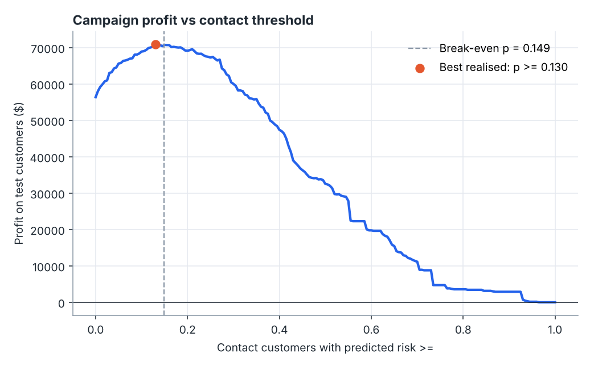

# Churn Intelligence

An end-to-end machine learning project that goes from raw customer records to a **dollar-value retention decision**, not just a model score.



## What it does

1. **Generates a realistic subscription dataset** (12,000 customers, missing values, an interaction effect, noisy labels) from a single seed, so every number is reproducible.
2. **Compares three model families** (logistic regression, random forest, gradient boosting) with stratified cross-validation on the training split only.
3. **Checks calibration** and applies isotonic calibration, because campaign maths needs probabilities that mean what they say.
4. **Turns probabilities into a decision**: contact a customer only when `p × save_rate × value > offer cost`. The break-even rule is fixed *before* looking at test labels.
5. **Explains and audits** the model with permutation importance on the raw columns and a per-contract performance check.

Everything lands in [`results/REPORT.md`](results/REPORT.md) with five figures and `metrics.json`.

## Headline results (seed 7, held-out test set)

| Strategy | Profit on 3,000 test customers |
| --- | --- |
| Contact nobody | $0 |
| Contact everyone | $56,376 |
| Random targeting, same volume | $34,114 |
| **Model with break-even rule** | **$70,785** |

- Test ROC AUC **0.784**; the riskiest decile churns at **63.7%** (2.4x the base rate).
- Contacting the top 30% of customers reaches about **60%** of churners.
- The realised-profit optimum (p ≥ 0.130) lands right next to the theoretical break-even threshold (0.149), which is a nice sanity check on the calibration.

### An honest finding

Regularised **logistic regression won**, and gradient boosting did not beat it. That is the correct outcome here: the synthetic data is generated from a mostly additive log-odds process, so a flexible model has little extra signal to find. The point of the project is the comparison discipline, not a fashionable model. The report also states plainly when calibration does not help.

> The data is synthetic, so these numbers demonstrate the method rather than real-world performance.

## Run it

Requires Python 3.10+ with `numpy`, `pandas`, `scikit-learn`, `matplotlib` (see `requirements.txt`).

```sh
python run.py            # full run, about 25 seconds, rewrites results/
python run.py --quick    # smaller models for a smoke test
python -m unittest discover -s tests -t .
```

Options: `--n` (customers), `--seed`, `--out` (output folder).

## Project layout

```
churn_intel/
  data.py        synthetic data generator, feature lists, target/id separation
  modeling.py    preprocessing pipeline, model zoo, calibration error, metrics
  business.py    retention economics, profit curves, lift and gains tables
  plots.py       headless matplotlib figures
  experiment.py  the full pipeline, from data to metrics.json
  report.py      Markdown report renderer
tests/           13 tests covering data, business maths, models and an end-to-end run
```

## Design decisions worth discussing

- **No leakage by construction**: `split_features_target` is the only way features are built; the label and customer id are tested to never be inputs.
- **Preprocessing lives inside the pipeline**, so imputation and scaling are fit on training folds only.
- **Missing values are informative**: the imputer adds missing-indicator columns instead of silently hiding gaps.
- **The decision rule is derived, not tuned**: break-even probability comes from the economics, and the hindsight threshold is shown only as an upper bound.
- **Assumptions are explicit and editable** in `RetentionEconomics`.

## Ideas to extend

Survival analysis for *when* a customer leaves, uplift modelling to target customers the offer actually changes, and drift monitoring on the score distribution.
