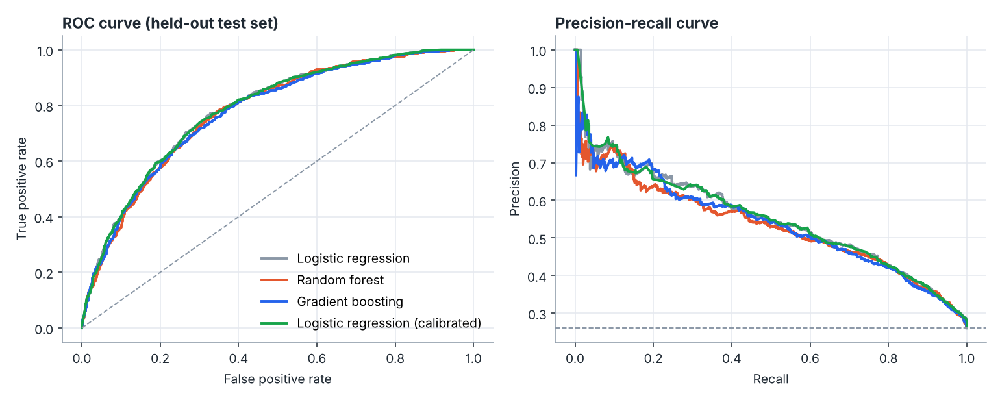
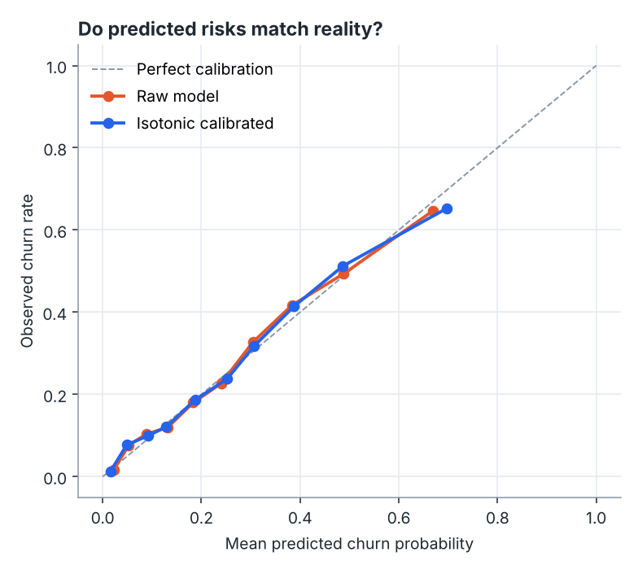
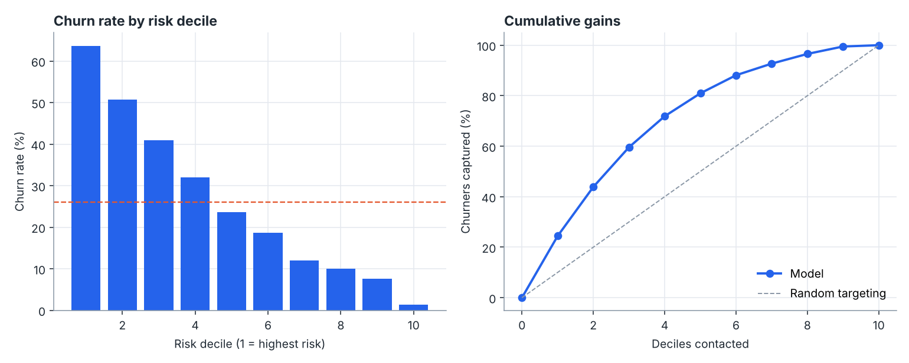
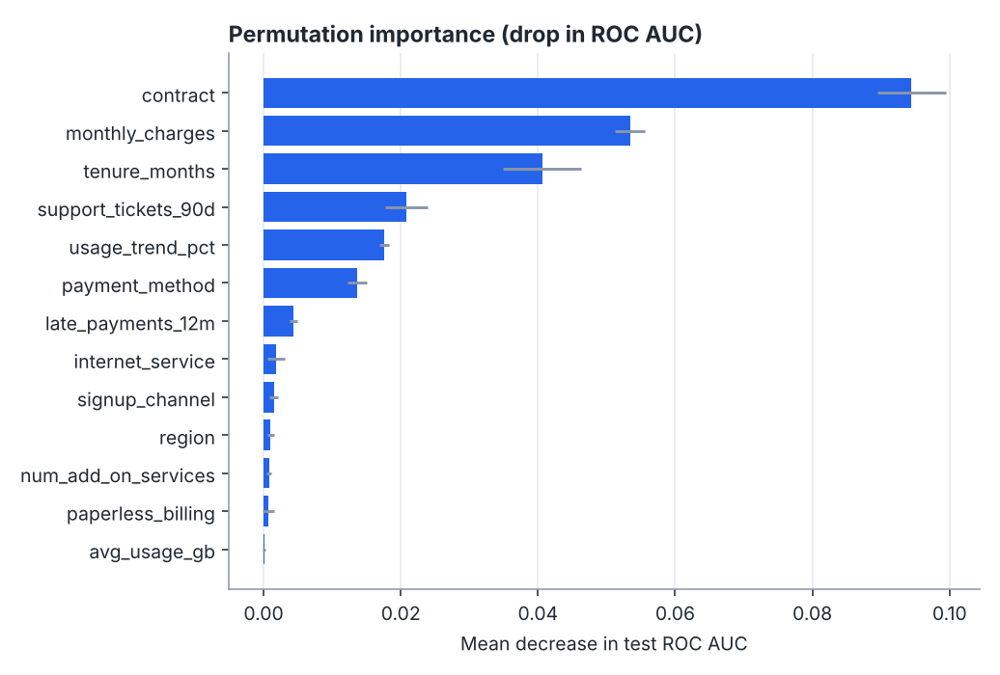

# Churn Intelligence: results report

Synthetic subscription business, 12,000 customers, base churn rate 26.1%. Stratified split: 9,000 train / 3,000 held-out test. Seed 7.

> The data is generated, so these numbers demonstrate the method rather than real-world performance.

## 1. Model comparison

Cross-validated on the training split only. **Logistic regression** won on ROC AUC and was carried forward.

| Model | CV ROC AUC | CV PR AUC | Test ROC AUC | Test PR AUC | Test Brier |
| --- | --- | --- | --- | --- | --- |
| Logistic regression | 0.784 ± 0.006 | 0.560 | 0.784 | 0.552 | 0.155 |
| Random forest | 0.777 ± 0.008 | 0.544 | 0.776 | 0.533 | 0.158 |
| Gradient boosting | 0.775 ± 0.004 | 0.538 | 0.775 | 0.539 | 0.157 |

## 2. Calibration

Ranking customers is not enough: the campaign maths needs probabilities that mean what they say.
Expected calibration error was **0.016** before and **0.020** after isotonic calibration (Brier 0.155 to 0.155). The selected model was already well calibrated, so calibration changed little; that is expected for regularised logistic regression and is why the check is worth running.

## 3. Where the churners are

The riskiest decile churns at 63.7% (2.4x the base rate). Contacting the top 30% reaches 60% of all churners.

## 4. Business decision

Assumptions: an offer costs $25, saves 35% of would-be churners, and each saved customer is worth $480. Contact a customer when predicted risk exceeds the break-even probability of **0.149**.

| Strategy | Profit on test customers |
| --- | --- |
| Contact nobody | $0 |
| Contact everyone | $56,376 |
| Random, same volume | $34,114 |
| Model, break-even rule | $70,785 |
| Model, best threshold (hindsight) | $70,908 |

The break-even rule is set before looking at the test labels, so it is an honest estimate. The hindsight threshold is shown only as an upper bound.

## 5. What drives churn

| Rank | Feature | Mean AUC drop when shuffled |
| --- | --- | --- |
| 1 | contract | 0.0944 |
| 2 | monthly_charges | 0.0534 |
| 3 | tenure_months | 0.0406 |
| 4 | support_tickets_90d | 0.0208 |
| 5 | usage_trend_pct | 0.0176 |
| 6 | payment_method | 0.0136 |
| 7 | late_payments_12m | 0.0044 |
| 8 | internet_service | 0.0019 |

## 6. Is it equally good for every contract type?

| Contract | Customers | Churn rate | ROC AUC |
| --- | --- | --- | --- |
| month-to-month | 1,635 | 36.8% | 0.716 |
| one-year | 723 | 18.1% | 0.761 |
| two-year | 642 | 7.6% | 0.772 |

Lower AUC inside a segment is expected because the contract type itself carried much of the signal; the useful check is that no segment collapses toward 0.5.
