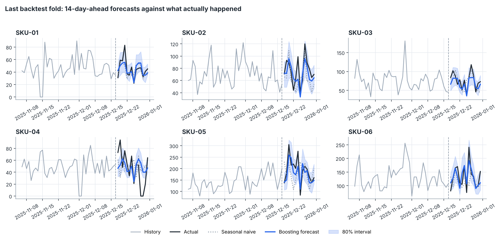

# Demand Forecasting Lab

A multi-series forecasting project built around one question: **how do you know a forecast is actually good?** Four forecasters compete under a rolling-origin backtest in which no model can see past its forecast date, and the winner is judged on promotions, uncertainty and stock decisions as well as raw error.



## What it does

1. **Simulates 6 product series over 4 years** with trend, yearly cycle, weekday shape, planned promotions, holidays, count noise and stock-outs.
2. **Benchmarks four models** over 8 non-overlapping folds of 14-day forecasts (112 test days per series):
   - seasonal naive and a 4-week seasonal average (the baselines any model must beat)
   - damped-trend Holt-Winters, written from scratch with a small parameter search
   - a **global gradient-boosted model** trained directly for horizons 1 to 14, using a ratio target so all series share what they learn
3. **Produces prediction intervals** with quantile boosting and checks whether the stated 80% band really covers 80%.
4. **Translates accuracy into inventory**: fill rate versus excess stock for three stocking policies.

Full write-up with all figures: [`results/REPORT.md`](results/REPORT.md).

## Headline results (seed 11)

| Model | WAPE | Bias | MASE |
| --- | --- | --- | --- |
| Seasonal naive | 31.4% | -3.5% | 1.31 |
| 4-week seasonal average | 25.8% | -4.6% | 1.05 |
| Damped Holt-Winters | 25.0% | -3.7% | 1.03 |
| **Global gradient boosting** | **19.2%** | +1.0% | **0.80** |

- **39% lower error** than seasonal naive.
- **The promotion story is the real finding.** Planned promotions are known in advance, but the three statistical baselines cannot use them and under-forecast promotion days by 27 to 30%. The boosted model is within 3%.
- At similar stock levels, the better forecast lifts fill rate from **90.9% to 98.0%**.
- The nominal 80% interval covered **76.0%** of outcomes. That is reported as is: slightly overconfident, which is normal for quantile models fitted to limited history.

### Limits worth saying out loud

- The data is synthetic, so the numbers show the method rather than real-world accuracy.
- Error does not grow with horizon here because the generator has no persistent shocks. Real demand usually gets harder further out, and the horizon chart is there to catch that.
- The 90th-percentile stocking policy added little over a flat buffer on the better forecast; the report says so instead of hiding it.

## Run it

Requires Python 3.10+ with `numpy`, `pandas`, `scikit-learn`, `matplotlib` (see `requirements.txt`).

```sh
python run.py             # full benchmark, about 40 seconds, rewrites results/
python run.py --quick     # smaller boosting models for a smoke test
python -m unittest discover -s tests -t .
```

Options: `--folds`, `--horizon`, `--seed`, `--out`.

## Project layout

```
forecast_lab/
  data.py        panel generator, holiday calendar
  features.py    leakage-safe lag, calendar and promotion features
  models.py      seasonal baselines, Holt-Winters, global boosting with quantiles
  backtest.py    rolling-origin folds and the evaluation loop
  metrics.py     WAPE, bias, MASE, interval coverage, fill rate
  experiment.py  benchmark orchestration
  plots.py / report.py
tests/           14 tests, including a future-leakage tamper test
```

## Design decisions worth discussing

- **Leakage is prevented structurally and tested.** Models receive `units[:, :origin + 1]`, a truncated array, so peeking forward cannot work. A test overwrites every post-origin sale with 9999 and asserts the feature frame is identical.
- **Direct multi-horizon forecasting** avoids feeding predictions back in as inputs, which compounds error in recursive approaches.
- **Ratio target** (sales divided by the recent 28-day mean) lets one model serve series whose volumes differ by 5x.
- **WAPE instead of MAPE**, because MAPE explodes on the zero-sales days that stock-outs create.
- **Known-future inputs are separated from unknown ones**: promotions and holidays may be read at the target date; sales may not.

## Ideas to extend

Hierarchical reconciliation across product groups, price elasticity as an extra planned input, conformal calibration of the intervals, and a cost-weighted loss so under-forecasting is penalised more than over-forecasting.
