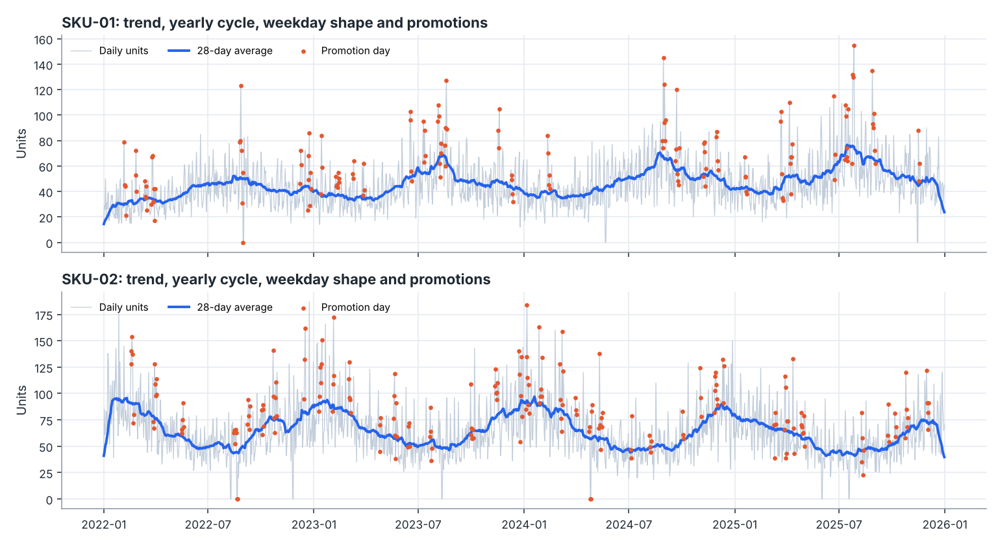
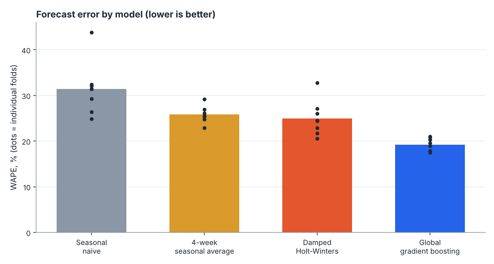
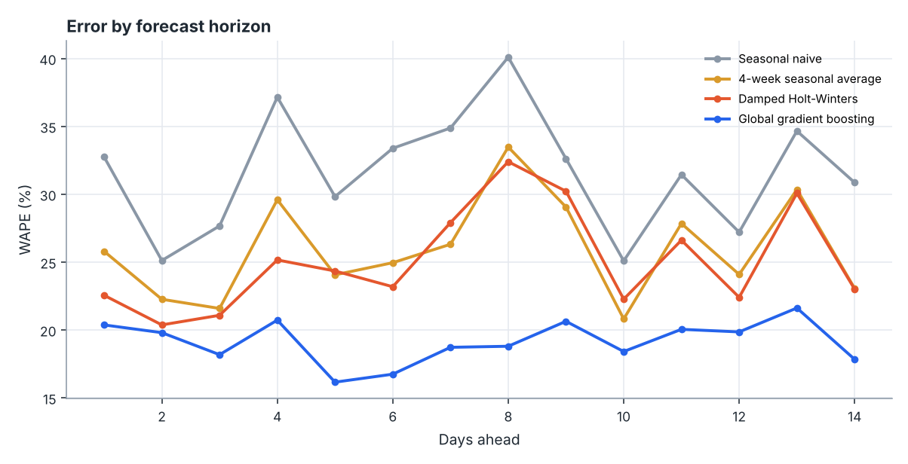
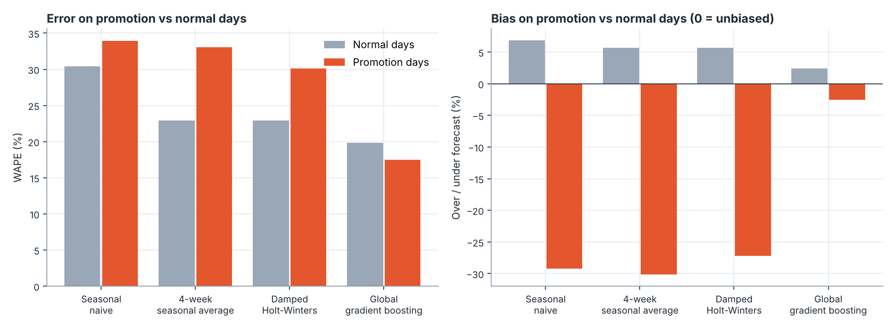

# Demand Forecasting Lab: results report

6 synthetic product series, 1,461 days (2022-01-01 to 2025-12-31), seed 11. Evaluation: **8 rolling-origin folds**, each forecasting 14 days ahead, spaced 28 days apart (2025-06-05 to 2025-12-31). Every model only sees data up to the forecast origin.

> The data is generated, so these numbers demonstrate the method rather than real-world performance.

## 1. Accuracy

WAPE is total absolute error divided by total demand, so it stays meaningful on days with very low sales. MASE below 1 means the model beats a seasonal-naive forecast made in-sample.

| Model | WAPE | MAE (units) | Bias | MASE |
| --- | --- | --- | --- | --- |
| Seasonal naive | 31.4% | 26.06 | -3.5% | 1.31 |
| 4-week seasonal average | 25.8% | 21.42 | -4.6% | 1.05 |
| Damped Holt-Winters | 25.0% | 20.73 | -3.7% | 1.03 |
| Global gradient boosting **(best)** | 19.2% | 15.91 | +1.0% | 0.80 |

The boosted model cut error by **39%** relative to the seasonal-naive baseline.

## 2. Error by horizon

## 3. Promotions

Promotions are planned, so they are known for future dates. Models that cannot use that information systematically miss the lift; the table shows over/under-forecasting on promotion days.

| Model | WAPE normal | WAPE promo | Bias normal | Bias promo |
| --- | --- | --- | --- | --- |
| Seasonal naive | 30.4% | 33.9% | +6.8% | -29.2% |
| 4-week seasonal average | 22.9% | 33.0% | +5.6% | -30.1% |
| Damped Holt-Winters | 22.9% | 30.1% | +5.7% | -27.2% |
| Global gradient boosting | 19.9% | 17.5% | +2.4% | -2.6% |

## 4. Uncertainty and inventory

The 10th-90th percentile band is meant to cover 80% of outcomes; it actually covered **76.0%**, with total width equal to 56% of demand.

Stocking decisions compared over the same test days (fill rate = demand served, excess = stock left over):

| Policy | Fill rate | Excess stock | Stock / demand |
| --- | --- | --- | --- |
| Seasonal naive + 25% buffer | 90.9% | 29.7% | 1.21 |
| Boosting forecast + 25% buffer | 98.0% | 28.2% | 1.26 |
| Boosting 90th percentile | 98.3% | 31.7% | 1.30 |

At a similar stock level (1.21x vs 1.26x demand), the more accurate forecast lifts fill rate from 90.9% to 98.0%. The 90th-percentile policy reaches 98.3% but holds 1.30x demand, so on this data it adds little over a flat buffer on the better forecast; the main value of the quantiles is the interval itself.

