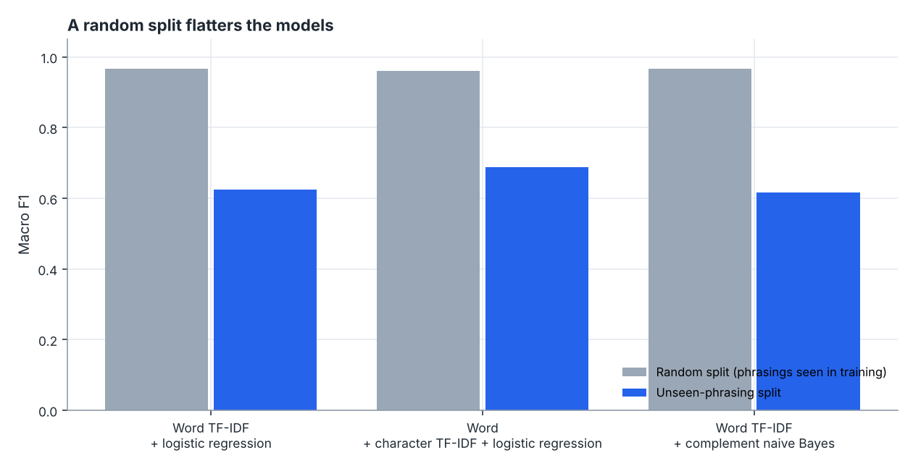

# Ticket Triage NLP

Classify support tickets, decide **which ones are safe to automate**, and find similar past tickets, with an evaluation designed to catch the ways text models fool their authors.



## What it does

1. **Generates 6,000 synthetic tickets** in 6 categories from 48 phrasing templates, with greetings, filler, typos, shared topical vocabulary and secondary issues (a billing complaint that also mentions a login problem). The label always follows the *primary* issue.
2. **Compares three classifiers**: word TF-IDF + logistic regression, word + character TF-IDF + logistic regression, and word TF-IDF + complement naive Bayes.
3. **Evaluates two ways**: a normal random split, and an **unseen-phrasing split** where whole templates are held out.
4. **Routes by confidence**: automate confident predictions, escalate the rest, with the threshold picked on training folds only.
5. **Stress-tests typos** and **searches similar tickets** with TF-IDF and latent semantic analysis (LSA).

Everything lands in [`results/REPORT.md`](results/REPORT.md) with six figures and `metrics.json`.

## Headline results (seed 5)

| Model | Macro F1, random split | Macro F1, unseen phrasings |
| --- | --- | --- |
| Word TF-IDF + logistic regression | 0.966 | 0.624 |
| Word + char TF-IDF + logistic regression | 0.961 | **0.689** |
| Word TF-IDF + complement naive Bayes (selected by CV) | 0.967 | 0.617 |

- **The random split is misleading.** Every model looks near-perfect (0.96+) when the same phrasings appear in training and test, and drops to 0.62 to 0.69 on wording it has never seen.
- Tickets with a secondary issue are much harder: **45% accuracy vs 69%** for single-issue tickets.
- Confidence routing handled **43.9%** of tickets automatically at **90.6%** accuracy, escalating 847 to people.
- Typos barely matter here (macro F1 moves by about 0.01 at 20% corrupted words) because the topical vocabulary is redundant.

### Things the report says out loud

- **Routing missed its target.** The threshold was tuned for 95% accuracy on training folds, but automated accuracy on unseen phrasings was 90.6%. Confidence learned on familiar wording is optimistic when wording shifts, which is exactly why you would monitor it in production.
- **Model selection and test disagree.** Grouped cross-validation picked naive Bayes, but the test split favours the character model. The report shows both rather than swapping in the better test number, which would make the test score optimistic.
- **The data is synthetic**, so the numbers demonstrate the method rather than real-world performance.

## Bugs found and fixed while building it

These are in the history of the design, and each has a regression test:

1. **Contaminated holdout.** Distractor sentences were drawn from every template, so "held-out" phrasings still appeared in training under other labels. The model learned them as anti-signals and scored *below chance* (macro F1 0.10). The unseen-phrasing split now removes any training ticket containing held-out wording, primary or secondary.
2. **Template starvation.** With no shared vocabulary between templates, no model could generalise (0.35 F1). Real customers reuse topical words, so the generator now includes them.
3. **Misleading "top words".** Bigrams like `pdf also` came from the "Also," marker across a sentence boundary. Stop words and bare numbers are now removed, and the chart shows real vocabulary (invoice, parcel, login).

## Run it

Requires Python 3.10+ with `numpy`, `scikit-learn`, `matplotlib` (see `requirements.txt`).

```sh
python run.py            # full study, about 20 seconds, rewrites results/
python run.py --quick    # fewer cross-validation folds
python -m unittest discover -s tests -t .
```

Options: `--n`, `--seed`, `--out`.

## Project layout

```
ticket_nlp/
  data.py        ticket generator, templates, typo injection
  models.py      classifiers, random and unseen-phrasing splits
  routing.py     confidence curves and threshold selection
  search.py      TF-IDF / LSA similar-ticket index and retrieval metrics
  experiment.py  the full study
  plots.py / report.py
tests/           16 tests, including a contamination regression test
```

## Design decisions worth discussing

- **Evaluate on what production looks like.** New tickets use new wording, so the headline number is the unseen-phrasing one.
- **Routing threshold is chosen on out-of-fold training predictions** and applied once to the test set.
- **Search and classification are separate tools.** The index returns similar tickets for an agent to read; the classifier decides routing.
- **No model selection on the test set**, and disagreements are reported.

## Ideas to extend

Sentence-embedding retrieval to compare with LSA, calibrated confidence for routing, active learning on the escalated tickets, and multi-label classification so a second issue is predicted instead of treated as noise.
