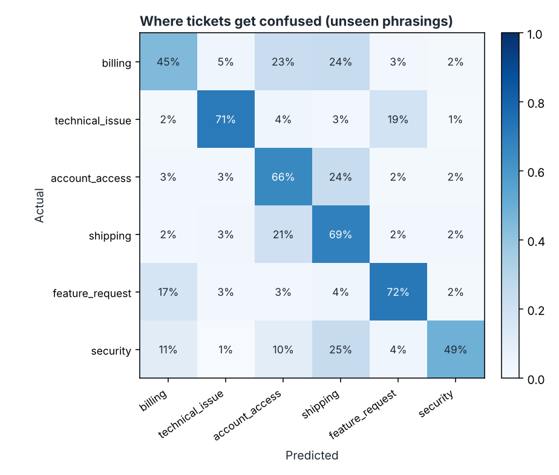
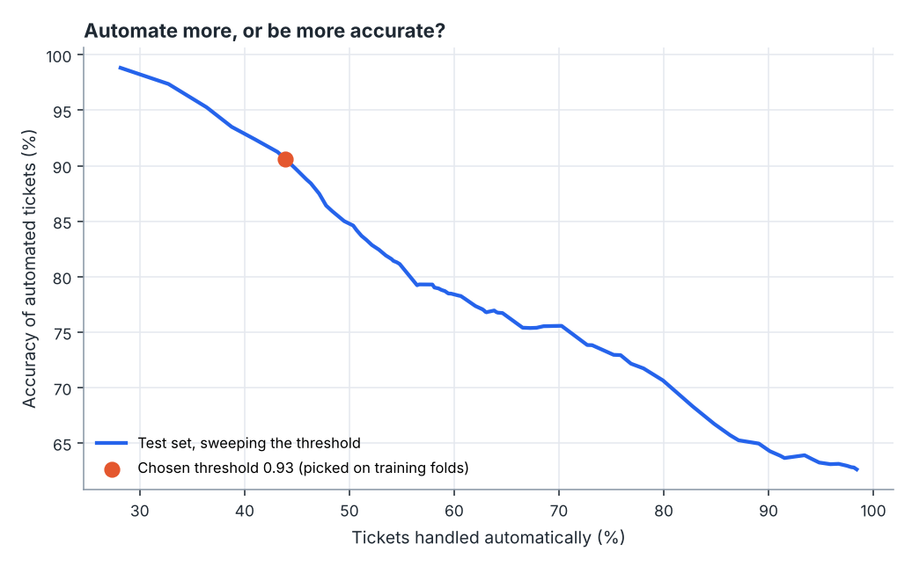
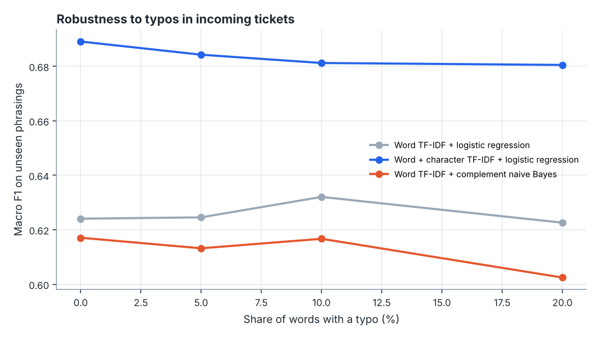
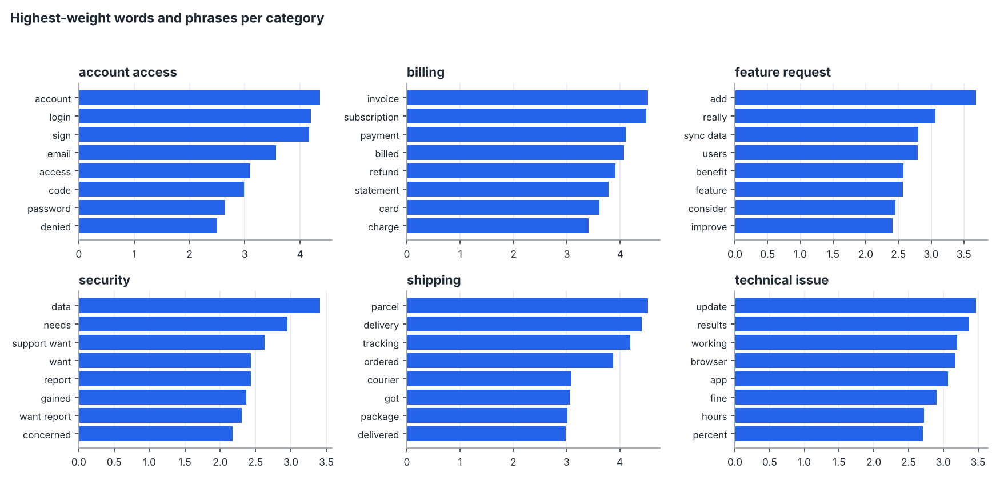
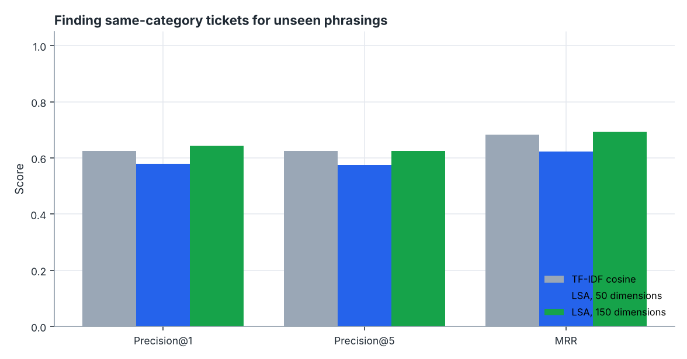

# Ticket Triage NLP: results report

6,000 synthetic support tickets across 6 categories, written from 48 phrasing templates plus greetings, filler, typos and secondary issues. Seed 5.

> The data is generated, so these numbers demonstrate the method rather than real-world performance.

## 1. Two ways to evaluate

A **random split** lets the same phrasings appear in training and test, which rewards memorisation. The **unseen-phrasing split** holds out whole templates (12 of 48, 1,509 test tickets), so the model must generalise to wording it has never seen. Model selection used grouped cross-validation on the training portion only.

| Model | Macro F1, random split | Macro F1, unseen phrasings | Grouped CV macro F1 |
| --- | --- | --- | --- |
| Word TF-IDF + logistic regression | 0.966 | 0.624 | 0.427 |
| Word + character TF-IDF + logistic regression | 0.961 | 0.689 | 0.476 |
| Word TF-IDF + complement naive Bayes **(selected)** | 0.967 | 0.617 | 0.491 |

Grouped CV is harsher than the final test: its folds hold out one primary template at a time, but that wording can still appear in the training folds as a *secondary* sentence under another label. It is used only to choose a model, and the test split is never used for selection. On this run the test split would have favoured **Word + character TF-IDF + logistic regression** (0.689 vs 0.617); that is reported rather than quietly swapped in, because choosing by test score would make the test number optimistic.

Selected model accuracy on unseen phrasings: **61.7%**. The random split overstated macro F1 by 0.350.

## 2. Where it goes wrong

Most frequent mistakes (actual → predicted): billing → shipping (78), billing → account_access (75), account_access → shipping (73), technical_issue → feature_request (57), shipping → account_access (43).

Accuracy is 69.4% for single-issue tickets and 45.3% when a second, different issue is mentioned. The label follows the *primary* issue, so those tickets are legitimately harder.

Examples of misclassified tickets:

- *"i need to update the credit card on file because my payment keeps getting declined"* — actual **billing**, predicted **shipping** (43% confident)
- *"Hey there, The discount code was not applied and I paid the full price of $49.00. Please get back to me as soon as possible."* — actual **billing**, predicted **account_access** (46% confident)
- *"we would love an option to schedule messages to send at a later time"* — actual **feature_request**, predicted **billing** (62% confident)
- *"the integration with our calendar keeps disconnecting and throws an authentication error"* — actual **technical_issue**, predicted **feature_request** (38% confident)

## 3. Safe automation

Tickets the model is confident about are routed automatically; the rest go to a person. The confidence threshold was chosen on out-of-fold training predictions to hit 95% accuracy, then applied once to the test set.

| Threshold | Handled automatically | Accuracy of automated tickets | Escalated to humans |
| --- | --- | --- | --- |
| 0.93 | 43.9% | 90.6% | 847 |

Automating every ticket would give 61.7% accuracy. The automated accuracy fell short of the target on unseen phrasings: confidence learned on training folds is somewhat optimistic when wording shifts, which is the reason to monitor it in production.

## 4. Robustness to typos

Test tickets were corrupted with extra swapped, dropped and doubled letters. Character n-grams let a model recognise a misspelled word from its pieces.

| Typo rate | Word TF-IDF + logistic regression | Word + character TF-IDF + logistic regression | Word TF-IDF + complement naive Bayes |
| --- | --- | --- | --- |
| 0% | 0.624 | 0.689 | 0.617 |
| 5% | 0.625 | 0.684 | 0.613 |
| 10% | 0.632 | 0.681 | 0.617 |
| 20% | 0.623 | 0.681 | 0.602 |

## 5. What the model learned

## 6. Similar-ticket search

Given a new ticket, retrieve the most similar past tickets. Relevant means same category; queries use unseen phrasings.

| Method | Precision@1 | Precision@5 | MRR |
| --- | --- | --- | --- |
| TF-IDF cosine | 0.625 | 0.625 | 0.684 |
| LSA, 50 dimensions | 0.580 | 0.575 | 0.623 |
| LSA, 150 dimensions **(best)** | 0.643 | 0.626 | 0.694 |

Sample queries answered by *LSA, 150 dimensions*:

**Query (billing):** i need to update the credit card on file because my payment keeps getting declined

- `0.57` [billing] My invoice for the starter plan shows the wrong total and I need a corrected receipt. This is abotu my invoic…
- `0.56` [billing] Can you send me a VAT invoice for the tem payment made on Monday?. This is about my invoice and the payment o…
- `0.56` [billing] Can you send me a VAT invoice for the strter payment made on last Friday?. This is about my invoice and the p…

**Query (technical_issue):** Hey there, The integration with our calendar keeps disconnecting and throws an authentication error. This is…

- `0.62` [shipping] Hey there, The courier left my parcel wiht a neighbour I do not know. This is quite urgent for us.
- `0.59` [feature_request] Hey there, Please consider adding an integration with Compass so we can sync our data. This is quite urgent f…
- `0.59` [technical_issue] Hey there, The page loads forevr and then shows a blank screen in the browser. This is quite urgent for us.

**Query (account_access):** Hello, I forgot which email I used to register and I cannot sign in. It seems to be a login problem with my e…

- `0.82` [account_access] Helloo, How do I change the email address linked to my login?. It seems to be a login problem with my email o…
- `0.82` [account_access] I am stuck in a login loop and it keeps sending me back to the sign in page. It seems to be a login problem w…
- `0.82` [account_access] I cannot log in to my account, the password reset email never arrives. It seems to be a login problem with my…

**Query (shipping):** Part of my orer #10452 is missing, only one of the two boxes came. The courier and the tracking information d…

- `0.69` [account_access] Hello, My account is locked after too many sign in attempts and I need it unlocked. Thanks for your help.
- `0.69` [account_access] Hello, My account is locked after too many sign in attempts and I need it unlocked. Thanks for your help.
- `0.68` [account_access] Dear support, My account is locked after too many sign in attempts and I need it unlocked. Thanks for your he…

**Query (feature_request):** we would love an option to schedule messages to send at a later time

- `0.60` [feature_request] Hello, Please consider adding an integration with Dashly so we can sync our data. It would really improve the…
- `0.57` [feature_request] Please consider adding an integration with Dashyl so we can sync our data.
- `0.56` [billing] Hey there, Can you send me a VAT invoice for the team payment made on last Friday?. Allso, please consider ad…

**Query (security):** Hi teaam, I think someone accessed my account, I see logins from a country I have nver visited. I am worried…

- `0.79` [security] Dear support, I want to reort a vulnerability that lets users see other customers data. I am worried about th…
- `0.76` [security] A phishing site is using your logo and I want to report it. I am worried about the safety and privacy of my d…
- `0.74` [security] Hi team, I received a suspicious email pretending to be from your company asking for my password. I am worrie…
