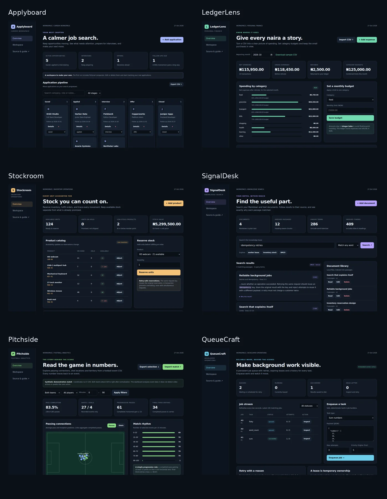

# Practical software projects

Six independently runnable applications covering full-stack product work, transactional backends, data ingestion, information retrieval, sports analytics and background processing.

| Project                   | What it does                                   | Engineering focus                                 | Local URL             |
| ------------------------- | ---------------------------------------------- | ------------------------------------------------- | --------------------- |
| [Applyboard](applyboard/) | A local job-application workspace              | Versioned edits, CRUD and activity history        | http://127.0.0.1:8101 |
| [LedgerLens](ledgerlens/) | An expense analytics application               | Exact money, atomic imports and deduplication     | http://127.0.0.1:8102 |
| [Stockroom](stockroom/)   | An inventory operations dashboard and REST API | Transactions, idempotency and concurrency         | http://127.0.0.1:8103 |
| [SignalDesk](signaldesk/) | A local Markdown and text search engine        | BM25, inverted indexes and source citations       | http://127.0.0.1:8104 |
| [Pitchside](pitchside/)   | A football event-analysis dashboard            | CSV analytics, visualizations and data provenance | http://127.0.0.1:8105 |
| [QueueCraft](queuecraft/) | A persistent background job queue              | Leases, retries, fencing and crash recovery       | http://127.0.0.1:8106 |

Every project has a working browser interface, its own API guide, persistent SQLite storage, fictional demo data, business-rule tests and an optional Dockerfile. Applications use only Python/Node built-ins plus plain HTML/CSS/JavaScript at runtime; no API keys, cloud accounts or database installation are needed.



## Open in VS Code

Use a sparse clone to avoid downloading the unrelated large datasets and videos in the repository:

```sh
git clone --depth 1 --filter=blob:none --sparse https://github.com/ToluwaniOyebode/Projects.git
cd Projects
git sparse-checkout set Portfolio-Projects
code Portfolio-Projects
```

Install **Python 3.12+** for the five Python apps and **Node.js 24.x** for Stockroom. From this folder:

```sh
python run.py applyboard
```

Replace `applyboard` with any folder name from the table. Use `py` on Windows if needed. `--port 9000` overrides the default port. Each project can also be copied into its own folder and run independently; read its README for the direct command.

## Validate the collection

```sh
python verify.py
```

Runs **45 domain tests**, JavaScript syntax checks and real HTTP integration checks against all six servers using temporary databases. Both Python 3.12+ and Node 24.x are required for the full check.

For optional browser acceptance tests, including desktop/mobile screenshots:

```sh
npm install --ignore-scripts
npx playwright install chromium
npm run test:browser
```

These development-only dependencies are unnecessary to run the apps. [GitHub Actions](../.github/workflows/portfolio-ci.yml) runs the same checks and uploads `portfolio-browser-results` with screenshots and a JSON report. See [VALIDATION.md](VALIDATION.md) for the measured validation record.

## Run all six with Docker

```sh
docker compose up --build
```

The Compose file binds each port to local loopback and uses separate named volumes. Docker recipes are supplied but were not executed in the initial workspace validation.

## Design choices

- **Local-first storage:** one SQLite file per app; parameterized SQL and bounded requests. No account or external service dependency.
- **Inspectable frontend:** native JavaScript modules, accessible labels, responsive layouts and real CRUD interactions.
- **Independent projects:** each folder includes its own HTTP adapter and shared design primitives, copied by value so it can run alone. Domain code is specific to each application.
- **Honest scope:** these are complete local applications, not deployed multi-user SaaS products. Synthetic data and hand-written scoring rules are labeled. No model-accuracy, customer-usage or production-scale claims are made.

The projects were created with AI assistance and include source, test evidence and tradeoffs for review. Before presenting one in an interview, run it, read the domain code and make a change you can explain. [INTERVIEW_GUIDE.md](INTERVIEW_GUIDE.md) provides demo routes and technical discussion prompts.

## License

MIT, scoped to this collection and the six new project folders. Existing repository projects retain their own licensing.
