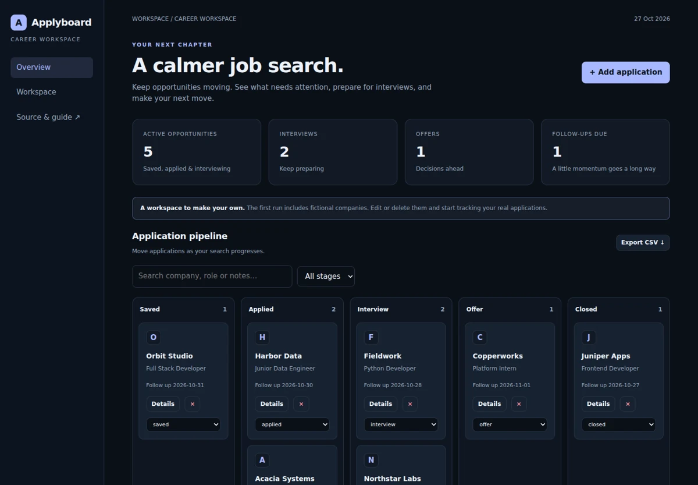

# Applyboard

### A calmer job search

A local job-application workspace with a five-stage pipeline, follow-up reminders, searchable notes and CSV exports.

**Python 3.12+ · SQLite · Vanilla JavaScript · Zero third-party runtime dependencies**



## Run locally

Open this project folder in VS Code and use its integrated terminal:

```sh
python server.py
```

Open **http://127.0.0.1:8101**. No npm/pip installation is needed to run the application. On Windows, use `py server.py` if `python` is not on PATH.

The first run creates `data.sqlite3` and loads fictional sample data. Changes persist across restarts.

## What works

- Create, edit, move and delete applications across saved, applied, interview, offer and closed stages.
- Track due follow-ups and inspect an activity log.
- Filter by company, role, notes or stage; export the current selection.
- Detect conflicting edits with version checks instead of silently overwriting a newer change.

## Two-minute demo

1. Add an application with a follow-up date in the past.
2. Move it to interview; inspect the activity log and follow-up list.
3. Edit its notes, filter by company, and export the CSV.

## How it works

SQLite stores applications and an append-only activity history. Each update runs under an immediate transaction and matches the expected version. An outdated editor receives HTTP 409. Follow-ups exclude closed applications and offers. The dashboard counts stages; its interview/offer percentage is a snapshot of current stages, not a historical funnel conversion.

## Tests

```sh
python -m unittest discover -s tests -v
```

6 domain tests cover business invariants and failures. The collection-level `python ../verify.py` runs every project plus live HTTP integration checks. Optional real-browser checks and responsive screenshots are produced by the [portfolio workflow](../../.github/workflows/portfolio-ci.yml).

## API

See [API.md](API.md) for endpoints and an executable request example. All API routes start with `/api`; `/api/health` reports readiness. Reads and successful writes return HTTP 200.

## Configuration

| Setting   | Default                       | Purpose            |
| --------- | ----------------------------- | ------------------ |
| `PORT`    | `8101`                        | HTTP listen port   |
| `HOST`    | `127.0.0.1`                   | Local-only binding |
| `DB_PATH` | `data.sqlite3` in this folder | SQLite file        |

The Python server also accepts `--port`, `--host` and `--db`. Example: `python server.py --port 9000 --db my-demo.sqlite3`.

## Docker (optional)

```sh
docker build -t applyboard .
docker run --rm -p 127.0.0.1:8101:8101 -v applyboard-data:/data applyboard
```

Container recipes are provided; Docker execution is not part of the local validation record. The parent folder includes a Compose file for all six apps.

## Scope and tradeoffs

One local user. Follow-ups are in-app lists, not email notifications. Deleting an application is permanent in the local database; activity remains. No authentication, recruiter scraping or automatic applications.

This is a complete local portfolio application, without public multi-user hosting or authentication. Keep it bound to loopback when working with personal data. To reset the demo, stop the server, back up your data, then remove its SQLite file and associated `-wal`/`-shm` files before restarting.

## Files to read first

- `service.py` — persistence, validation and business rules.
- `server.py and webcore.py` — HTTP boundary and startup.
- `static/app.js` — complete frontend interactions.
- `tests/` — concrete examples of correct behavior and rejected inputs.

[MIT licensed](LICENSE). Built with AI assistance; source and tests are available for inspection.
