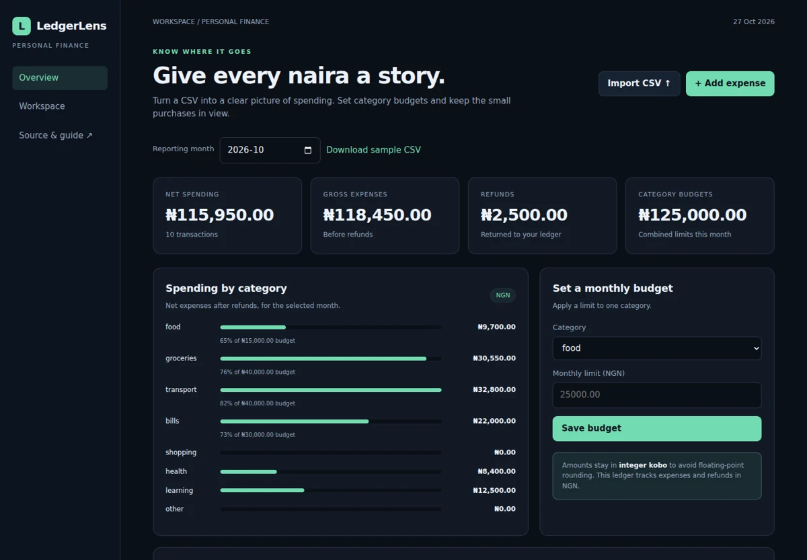

# LedgerLens

### Give every naira a story

An expense analytics application with exact money arithmetic, category budgets and validated CSV ingestion.

**Python 3.12+ · SQLite · Vanilla JavaScript · Zero third-party runtime dependencies**



## Run locally

Open this project folder in VS Code and use its integrated terminal:

```sh
python server.py
```

Open **http://127.0.0.1:8102**. No npm/pip installation is needed to run the application. On Windows, use `py server.py` if `python` is not on PATH.

The first run creates `data.sqlite3` and loads fictional sample data. Changes persist across restarts.

## What works

- Track expenses and refunds in NGN using integer kobo.
- Import up to 2,000 CSV rows atomically and skip duplicate transactions.
- Categorize descriptions with inspectable keyword rules, then override categories manually.
- Review monthly totals, category budgets, historical spending bars and CSV exports.

## Two-minute demo

1. Download the sample CSV and import it. Change the reporting month to 2026-10.
2. Import the same CSV again to see duplicate rows skipped.
3. Add a negative expense as a refund and set a category budget.

## How it works

Decimal strings become integer kobo before persistence. Positive values are expenses; negative values are refunds. A SHA-256 fingerprint of date, normalized description and amount prevents repeat imports. All CSV rows are validated before a transaction writes any of them. Budgets apply to a category in a specific month. The trend shows the latest six months that contain transactions.

## Tests

```sh
python -m unittest discover -s tests -v
```

8 domain tests cover business invariants and failures. The collection-level `python ../verify.py` runs every project plus live HTTP integration checks. Optional real-browser checks and responsive screenshots are produced by the [portfolio workflow](../../.github/workflows/portfolio-ci.yml).

## API

See [API.md](API.md) for endpoints and an executable request example. All API routes start with `/api`; `/api/health` reports readiness. Reads and successful writes return HTTP 200.

## Configuration

| Setting   | Default                       | Purpose            |
| --------- | ----------------------------- | ------------------ |
| `PORT`    | `8102`                        | HTTP listen port   |
| `HOST`    | `127.0.0.1`                   | Local-only binding |
| `DB_PATH` | `data.sqlite3` in this folder | SQLite file        |

The Python server also accepts `--port`, `--host` and `--db`. Example: `python server.py --port 9000 --db my-demo.sqlite3`.

## Docker (optional)

```sh
docker build -t ledgerlens .
docker run --rm -p 127.0.0.1:8102:8102 -v ledgerlens-data:/data ledgerlens
```

Container recipes are provided; Docker execution is not part of the local validation record. The parent folder includes a Compose file for all six apps.

## Scope and tradeoffs

Single-currency expense tracking, not a banking integration or double-entry accounting system. Categories use rules, not machine learning. Identical date/description/amount combinations are treated as duplicates even if they represent two separate real purchases. The schema has no bank transaction ID.

This is a complete local portfolio application, without public multi-user hosting or authentication. Keep it bound to loopback when working with personal data. To reset the demo, stop the server, back up your data, then remove its SQLite file and associated `-wal`/`-shm` files before restarting.

## Files to read first

- `service.py` — persistence, validation and business rules.
- `server.py and webcore.py` — HTTP boundary and startup.
- `static/app.js` — complete frontend interactions.
- `tests/` — concrete examples of correct behavior and rejected inputs.

[MIT licensed](LICENSE). Built with AI assistance; source and tests are available for inspection.
